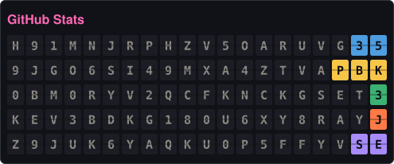
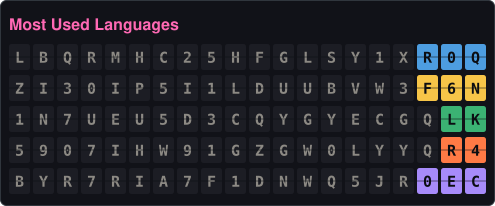

  

Software Engineering student at Ontario Tech. I like building tools around real-world data, and lately I'm getting into hardware.

| Project | What it does | Built with |
| --- | --- | --- |
| [Satellite Detector](https://github.com/valerie-ekeigwe/satellite-detector) | Finds satellites in night-sky video by modelling the still stars, flagging what moves, and tracking it frame to frame | Python, NumPy, OpenCV |
| [Contribution Sky](https://github.com/valerie-ekeigwe/contribution-sky) | Redraws my contribution graph every night as a sky that a satellite sweeps across | Python, GitHub Actions, SVG |

  
  

&nbsp; [LinkedIn](https://www.linkedin.com/in/valerieekeigwe) &nbsp;·&nbsp; [Email](mailto:valeriecekeigwe@gmail.com)
